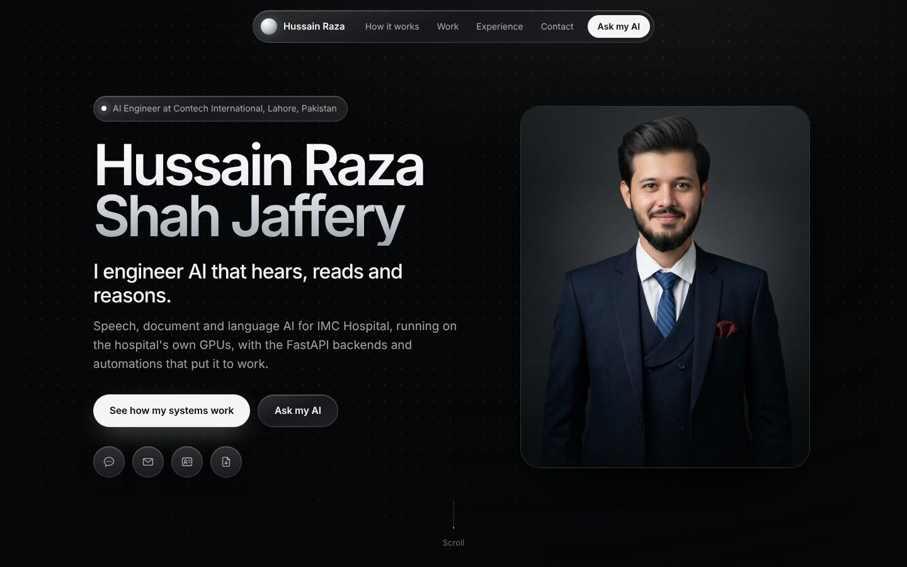
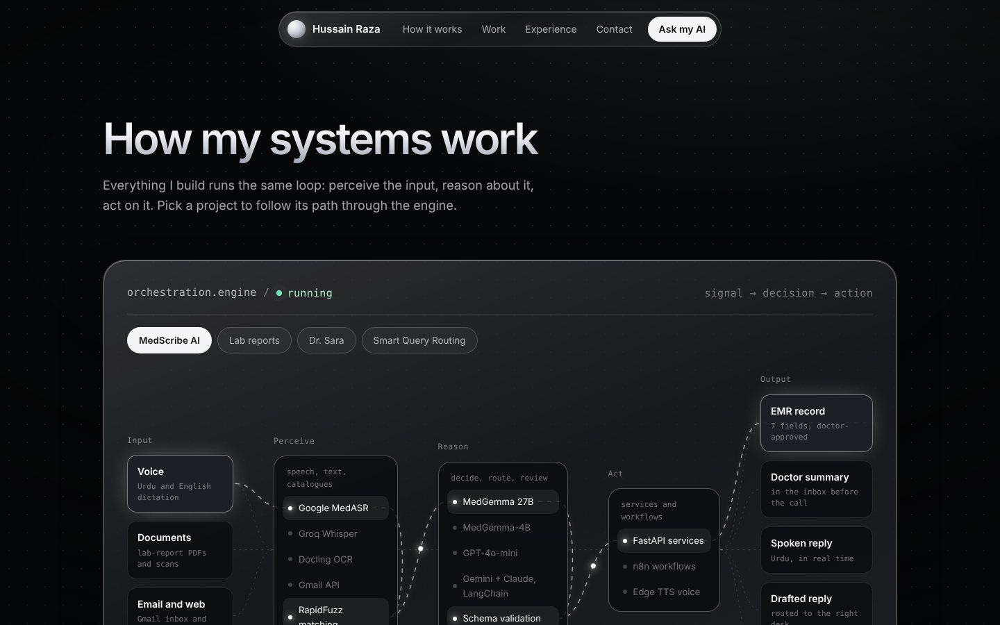

# Hussain Raza Shah Jaffery: AI Engineer portfolio

**Live site: [hussain-raza-ai.vercel.app](https://hussain-raza-ai.vercel.app)**

The portfolio of an AI engineer who builds speech, document and language AI. It shows five systems as
case studies, a live view of how they work, and an assistant that answers questions about the work.



## What's on the site

- **How my systems work:** an orchestration engine. Pick a project and its path lights up from the input
  (voice, documents, inbox) through perception, reasoning and action to the result.
- **Five case studies:** MedScribe AI, Smart Query Routing, Lab Report Extraction, University ERP & LMS and
  Dr. Sara. Each one covers the problem, every step of the pipeline, what I built and the results.
- **Ask my AI:** answers questions about my projects, stack and experience, straight from the facts on the site.
- **Contact and CV:** WhatsApp, email, LinkedIn and a downloadable CV.



## Built with

Next.js 16 (App Router), React 19, TypeScript and plain CSS, deployed on Vercel. The motion, the pointer and
the 3D project corridor are written by hand without animation libraries, and every animation loop stops when
nothing is moving.

## Run it on your computer

You need Node.js 20 or newer.

```bash
npm install
npm run dev
```

Open http://localhost:3000.

## Update your details

Everything you are likely to change lives in `src/content/`:

| File | What it holds |
|---|---|
| `site.ts` | Email, WhatsApp, LinkedIn, GitHub, photo, CV link, site address |
| `projects.ts` | The five case studies, their pipelines, and the "in progress" line |
| `profile.ts` | Experience, skills, education, certification |
| `knowledge.ts` | The answers the "Ask my AI" panel gives |
| `engine.ts` | The orchestration engine: inputs, stages, tools, outputs and each project's path |

Empty values in `site.ts` (email, GitHub, CV) are hidden on the site until you fill them in.

Your CV is already in `public/Hussain_Raza_Shah_Jaffery_CV.pdf` and linked from the hero icons and the
contact section. To update it, replace that file with a new PDF of the same name.

## Your photo

Your portrait is `public/hussain.jpg` (4:5 studio portrait on a graphite backdrop that matches the site).
To change it, replace that file with another vertical 4:5 photo of the same name.
Set `photo: ""` in `src/content/site.ts` to show your initials instead.

## Deploy on Vercel

1. Create a new repository on GitHub and push this folder to it.
2. On vercel.com, choose **Add New → Project** and import the repository.
3. Keep the default settings (Vercel detects Next.js) and click **Deploy**.
4. Once it is live, copy the address into `url` in `src/content/site.ts` and push again,
   so link previews and the sitemap use the right address.

## How it is built

- Next.js 16 App Router, React 19, TypeScript
- No UI or animation libraries: everything below is hand-written and dependency-free
- `BackgroundField.tsx`: a still CSS dot grid with a lens of brighter dots that follows the mouse
- `Orchestrator.tsx`: the orchestration engine; each project's path lights up and signals run along it
- `HeroSpatial.tsx`: big name and the portrait, which leans a few degrees towards the pointer
- `ContactIcons.tsx`: magnetic glass icons for WhatsApp, email, LinkedIn and the CV, with hover labels
- Case studies (`CaseNav.tsx`, `.case` in `globals.css`): a slate reading room with the system running live in the hero,
  a reading progress bar, a section bar that follows you, steps that light up as you scroll, and checked results
- `Monoliths.tsx`: the work corridor; scrolling flies a perspective camera through glass monoliths
  with pointer tilt and a specular highlight that follows the hand
- `SkillField.tsx`: the skill under the pointer lifts, lights up and leans towards it
- `Magnetic.tsx`: buttons lean a few pixels towards the pointer
- `Cursor.tsx`: an iPadOS / visionOS style pointer: a soft dot that melts into a highlight around
  buttons, links and icons, becomes an "Open" disc over large cards and a caret over text fields
- Built for speed: no live blur on scrolling content, no layout reads inside animation frames,
  every animation loop stops when nothing is moving, and looping animations pause off screen
- `src/lib/motion.ts`: the shared spring physics and pointer state
- Plain CSS with design tokens in `src/app/globals.css`; fonts through `next/font`
  (Inter, JetBrains Mono, Noto Nastaliq Urdu)
- On phones, and for visitors who prefer reduced motion, the corridor becomes a calm stack and
  the effects switch off
- "Ask my AI" runs entirely in the browser from `src/content/knowledge.ts`; nothing is sent anywhere
- Every page is pre-rendered at build time
